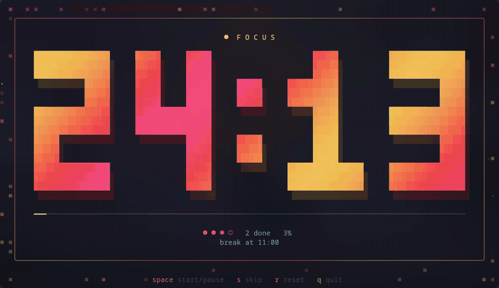

<div align="center">

# 🍅 waybar-pomodoro

**A Pomodoro timer that lives in your Waybar, with an animated terminal view for when you want it big.**

Pure bash + Python stdlib · no daemon · state survives Waybar restarts



<sub>Focus → pause → resume → skip to a break → the final minute</sub>

<br><br>


<sub>The module in the bar, next to the rest of the right-hand modules</sub>

</div>

---

## Features

- **Lives in the bar.** Countdown with an icon for each phase. The color follows the phase (focus, short break, long break), the module dims while idle, and it pulses when paused or in the last minute.
- **Click to control.** Left-click starts or pauses, right-click resets, middle-click opens the terminal view.
- **Full Pomodoro cycle.** Focus, short break, then a long break every *N* sessions, with optional auto-start of the next phase.
- **Notifications and sound** at every phase change, through `notify-send` and `paplay` if you have them.
- **Animated terminal view.** Big pixel digits with a moving gradient, a starfield that speeds up as time runs out, a shimmering progress bar, session dots, and the time the next phase starts.
- **One shared state.** The bar and the terminal view read the same state file, so you can control the timer from either one.
- **Light.** One small bash script that Waybar calls once a second. Nothing runs in the background.

## Requirements

| Required | Optional |
| --- | --- |
| `bash`, `python3`, `flock` (util-linux) | `notify-send` for notifications |
| [Waybar](https://github.com/Alexays/Waybar) | `paplay` + freedesktop sound theme for the chime |
| A [Nerd Font](https://www.nerdfonts.com/) in your bar | A truecolor terminal (kitty, Alacritty, Ghostty, foot…) |

## Install

```sh
git clone https://github.com/Dzzuy/waybar-pomodoro.git
cd waybar-pomodoro

mkdir -p ~/.config/waybar/scripts
cp pomodoro.sh pomodoro-tui.py ~/.config/waybar/scripts/
chmod +x ~/.config/waybar/scripts/pomodoro*
```

### 1. Add the module

Paste the block from [`config.jsonc`](config.jsonc) into your Waybar config. Then add `"custom/pomodoro"` to a module list, for example as the first entry of `modules-right`:

```jsonc
"modules-right": ["custom/pomodoro", "pulseaudio", "network", ...],

"custom/pomodoro": {
  "exec": "~/.config/waybar/scripts/pomodoro.sh status",
  "return-type": "json",
  "interval": 1,
  "signal": 8,
  "tooltip": true,
  "on-click": "~/.config/waybar/scripts/pomodoro.sh toggle",
  "on-click-right": "~/.config/waybar/scripts/pomodoro.sh reset",
  "on-click-middle": "kitty --class pomodoro -e ~/.config/waybar/scripts/pomodoro-tui.py"
}
```

> [!TIP]
> Change `on-click-middle` to match your terminal:
> `alacritty --class pomodoro -e …` · `ghostty --class=pomodoro -e …` · `foot --app-id pomodoro …`

### 2. Add the styles

```sh
cat style.css >> ~/.config/waybar/style.css
```

On **ML4W dotfiles**, add it to your theme's `style-custom.css` instead (for example `~/.config/waybar/themes/<theme>/default/style-custom.css`) so theme updates don't overwrite it.

### 3. Restart Waybar

```sh
pkill waybar; waybar & disown          # generic
~/.config/waybar/launch.sh             # ML4W
omarchy-restart-waybar                 # Omarchy
```

## Usage

### In the bar

| Action | Result |
| --- | --- |
| **Left-click** | Start / pause |
| **Right-click** | Restart the current phase. Right-click again to go back to session 1 |
| **Middle-click** | Open the animated terminal view |
| **Hover** | Phase, session dots, and sessions completed |

### In the terminal

```sh
~/.config/waybar/scripts/pomodoro-tui.py
# or
~/.config/waybar/scripts/pomodoro.sh tui
```

| Key | Action |
| --- | --- |
| <kbd>Space</kbd> / <kbd>Enter</kbd> | Start / pause |
| <kbd>s</kbd> | Skip to the next phase |
| <kbd>r</kbd> | Reset |
| <kbd>q</kbd> / <kbd>Esc</kbd> | Quit (the timer keeps running in the bar) |

### From scripts or keybinds

```sh
pomodoro.sh status   # JSON for Waybar
pomodoro.sh toggle   # start / pause
pomodoro.sh reset    # restart phase (twice = back to session 1)
pomodoro.sh skip     # jump to the next phase
pomodoro.sh tui      # open the terminal view
```

## Hyprland: a keybind and a dedicated window

<details>
<summary><b>hyprland.conf</b> (classic syntax)</summary>

```ini
bind = SUPER ALT, P, exec, kitty --class pomodoro -e ~/.config/waybar/scripts/pomodoro-tui.py

# show it fullscreen on your second monitor
windowrule = monitor 1, class:pomodoro
windowrule = fullscreen, class:pomodoro
```

</details>

<details>
<summary><b>Lua config</b> (Hyprland ≥ 0.56)</summary>

```lua
hl.bind("SUPER + ALT + P",
    hl.dsp.exec_cmd("kitty --class pomodoro -e ~/.config/waybar/scripts/pomodoro-tui.py"),
    { description = "Pomodoro timer" })

hl.window_rule({
    name = "pomodoro",
    match = { class = "pomodoro" },
    float = true,
    center = true,
    size = "1180 680"
})
```

</details>

## Configuration

Set these in the environment Waybar starts with, for example `~/.config/uwsm/env` or your Hyprland env config:

```sh
export POMO_WORK=50 POMO_SHORT=10 POMO_LONG=20 POMO_LONG_EVERY=4 POMO_AUTOSTART=1
```

| Variable | Default | Meaning |
| --- | --- | --- |
| `POMO_WORK` | `25` | Focus length (minutes) |
| `POMO_SHORT` | `5` | Short break (minutes) |
| `POMO_LONG` | `15` | Long break (minutes) |
| `POMO_LONG_EVERY` | `4` | Long break after this many focus sessions |
| `POMO_AUTOSTART` | `1` | `1` = start the next phase right away, `0` = wait for a click |
| `POMO_SIGNAL` | `8` | Real-time signal used to refresh Waybar (must match `"signal"` in the module) |

### Styling

The module sets CSS classes for the phase (`work`, `short`, `long`), the status (`running`, `paused`, `idle`), and `ending` in the last 60 seconds. You can restyle any combination:

```css
#custom-pomodoro.work.running  { color: #f38ba8; }
#custom-pomodoro.short.running { color: #94e2d5; }
#custom-pomodoro.long.running  { color: #89b4fa; }
#custom-pomodoro.ending        { animation: pomo-breathe 0.5s ease-in-out infinite alternate; }
```

## How it works

```
 Waybar ──(every 1s)──▶ pomodoro.sh status ──▶ JSON {text, class, tooltip, percentage}
   │                         │
   │ clicks                  ├─ reads/writes  ~/.cache/waybar-pomodoro/state
   ▼                         ├─ advances the phase when time runs out → notify-send + paplay
 pomodoro.sh toggle/reset    └─ pkill -RTMIN+8 waybar   (instant refresh)
                             ▲
 pomodoro-tui.py ────────────┘  (redraws 24 times a second from the same state file)
```

The state is a five-line file that stores the **end timestamp**, not a running counter, so the countdown stays correct through Waybar restarts, suspend, and relogin. `flock` serialises concurrent calls, so a click landing during a status poll can't corrupt it.
